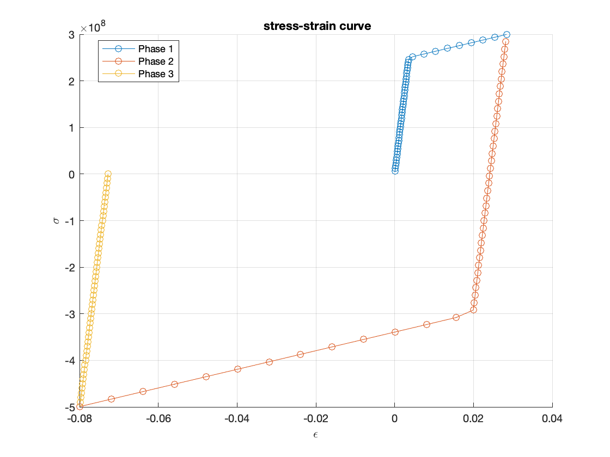
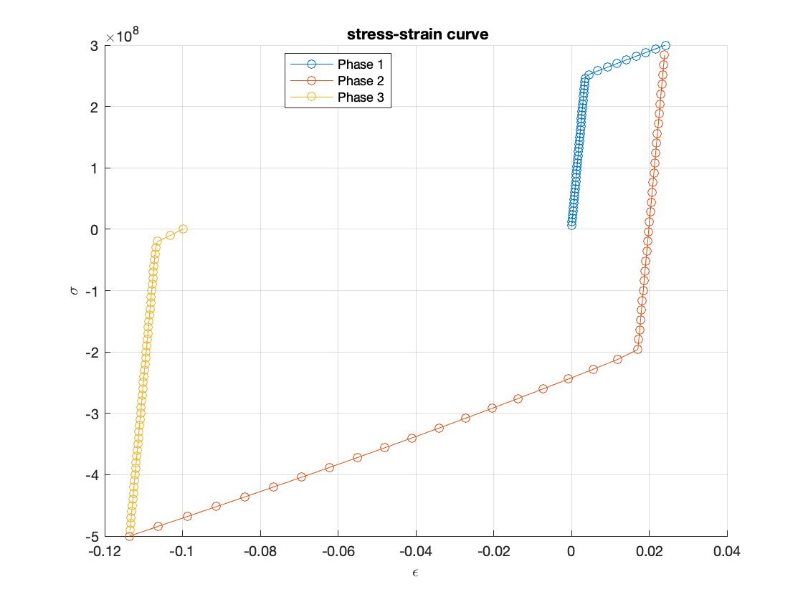
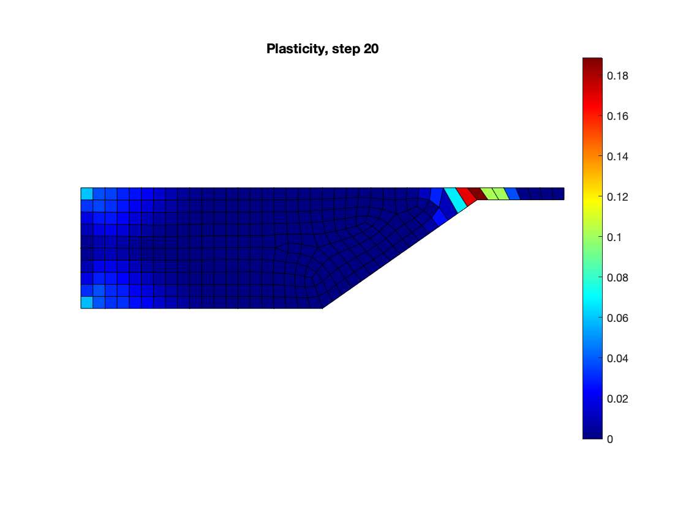

# Elasto-Plastic Finite Element Solver (von Mises Plasticity)

An incremental-iterative finite element solver written in Fortran for rate-independent **von Mises plasticity** with **isotropic** and **kinematic hardening**, with MATLAB scripts for post-processing.

Developed as a team of two for the *FEM-Heavy* course (41525) at the Technical University of Denmark (DTU), 2025.

<!-- TODO: add one sentence on attribution, e.g. what the course provided (base FE framework) and what you wrote (plasticity routines, tangent, post-processing). -->

## Features

- Newton–Raphson solution of the nonlinear equilibrium equations over prescribed load increments
- Return-mapping stress update at every Gauss point
- Consistent elasto-plastic tangent stiffness
- **Isotropic hardening**: the yield surface expands with accumulated plastic strain
- **Linear kinematic hardening** (Prager type): the yield surface translates in stress space through a backstress
- 2D 4-node plane-stress element (`plane42`) and 1D bar element (`link1`)
- MATLAB scripts for stress–strain curves and plastic strain maps

## Method in brief

For each load increment, the strain increment at every Gauss point is $\Delta\boldsymbol{\varepsilon} = \mathbf{B}\,\Delta\mathbf{d}$ and the elastic trial stress is $\boldsymbol{\sigma}^{\text{trial}} = \boldsymbol{\sigma}_{n-1} + \mathbf{C}\,\Delta\boldsymbol{\varepsilon}$.

If the von Mises equivalent stress of the trial state exceeds the current yield stress, the point yields and the stress is returned to the yield surface:

$$\Delta\lambda = \frac{\mathbf{n}^T \mathbf{C}\,\Delta\boldsymbol{\varepsilon}}{\mathbf{n}^T \mathbf{C}\,\mathbf{n} + H}, \qquad \boldsymbol{\sigma}_n = \boldsymbol{\sigma}^{\text{trial}} - \Delta\lambda\,\mathbf{C}\,\mathbf{n}$$

with flow direction $\mathbf{n} = \partial F / \partial \boldsymbol{\sigma}$ and hardening modulus $H$. The same structure gives the tangent used in the global Newton iterations:

$$\mathbf{C}_{ep} = \mathbf{C} - \frac{\mathbf{C}\,\mathbf{n}\,\mathbf{n}^T\mathbf{C}}{\mathbf{n}^T\mathbf{C}\,\mathbf{n} + H}$$

The two hardening models differ only in the constitutive update:

| Model | Yield function | Internal variable |
|---|---|---|
| Isotropic | $F = \sigma_{eq} - \sigma_y(\varepsilon^p)$, $\ \sigma_y = \sigma_{y0} + h\,\varepsilon^p$ | yield stress $\sigma_y$ grows |
| Kinematic | $F = \sigma_{eq}(\boldsymbol{\sigma} - \boldsymbol{\alpha}) - \sigma_{y0}$ | backstress $\boldsymbol{\alpha}$ moves the centre of the surface |

## Verification

### Single-element test against analytical solutions

A single `plane42` element under uniaxial loading isolates the material routine from structural effects. Material: $E = 70$ GPa, tangent modulus $E_t = 2$ GPa, $\sigma_{y0} = 250$ MPa, so that $h = E E_t / (E - E_t) = 2.0588$ GPa. The load history has three phases of 50 steps each: tension to +300 MPa, reverse loading to −500 MPa, and unloading (the unloading phase is not part of the analytical solution).

The simulated stress–strain curves follow the hand-derived solutions closely for both models.

**Isotropic hardening** — analytical values:

| Stage | σ [MPa] | ε | ε<sup>p</sup> | Yield stress σ<sub>y</sub> [MPa] |
|---|---|---|---|---|
| A (first yield) | +250 | 0.003571 | 0 | 250 |
| B (tension) | +300 | 0.028571 | +0.024286 | 300 |
| C (elastic reversal) | −300 | 0.020000 | +0.024286 | 300 |
| D (compression) | −500 | −0.080000 | −0.072857 | 500 |

**Kinematic hardening** — analytical values (Bauschinger effect: yielding in compression starts at −200 MPa instead of −300 MPa):

| Stage | σ [MPa] | ε | ε<sup>p</sup> | Backstress α [MPa] |
|---|---|---|---|---|
| A (first yield) | +250 | 0.003571 | 0 | 0 |
| B (tension) | +300 | 0.028571 | +0.024286 | +50 |
| C (elastic reversal) | −200 | 0.021429 | +0.024286 | +50 |
| D (compression) | −500 | −0.128571 | −0.121429 | −250 |

| Isotropic hardening | Kinematic hardening |
|---|---|
|  |  |

*Stress–strain curves in the loading direction (stress in Pa). Phase 1: tension, phase 2: reverse loading, phase 3: unloading.*

### Multiaxial benchmark

To test the solver beyond uniaxial stress, a stepped plate (2 cm thick) with a thin section is loaded by a distributed load. Parameters: $E = 210$ GPa, $\sigma_{y0} = 355$ MPa, $E_t = 3$ GPa, $q = 20$ MPa, 20 load increments. Two meshes were used: a coarse one with 293 elements and a fine one with 1,780 elements.

| Coarse mesh (293 elements) | Fine mesh (1,780 elements) |
|---|---|
|  |  |

*Equivalent plastic strain at load step 20. The colour scales differ between the two plots.*

Observations:

- Plasticity starts in the thin section, where bending produces the highest von Mises stress, and spreads from there; smaller plastic zones appear near the clamped corners.
- The predicted plastic strain depends strongly on the mesh: the fine mesh gives substantially larger values and sharper localisation, locally above 50 %, which is not physical for structural steel.
- This is consistent with the known behaviour of classical rate-independent J2 plasticity: once flow localises, the problem loses ellipticity and the strain field does not converge under mesh refinement. A mesh-objective result would need a regularisation technique, which is beyond the scope of this project.

## Known limitations

- No regularisation of strain localisation (see above), so local plastic strains are mesh dependent.
- During plastic loading, the Newton iterations often need several hundred iterations (around 500 in the benchmark), and the method is sensitive to large load increments. The load step size and mesh must be chosen with care.
- Only plane-stress 4-node elements and bar elements are implemented.

## Repository structure

```
.
├── main.f90                   # main program: incremental loop and Newton iterations
├── types.f90, fedata.f90      # data structures and global parameters
├── fea.f90                    # FEA routines
├── plane42.f90                # 4-node 2D element, tangent stiffness assembly
├── link1.f90                  # 1D bar element
├── numeth.f90, processor.f90  # numerical methods and step processing
├── test.txt                   # example input: geometry and load increments
├── plot_stress_strain.m       # MATLAB: stress–strain curves
├── plasticity_scale.m         # MATLAB: spatial distribution of plastic strain
└── docs/figures/              # images used in this README
```

Output files written by the solver:

- `results.dat`: displacements and forces
- `stress_log.dat`: stress states
- `gauss_stress_history.dat`: stress history at the Gauss points

## Build and run

Requires `gfortran`.

```bash
gfortran types.f90 fedata.f90 numeth.f90 plane42.f90 link1.f90 fea.f90 processor.f90 main.f90 -o fem_solver
```

<!-- TODO: add the exact run command and how the input file is passed, e.g.: ./fem_solver test.txt -->

Then run the MATLAB scripts `plot_stress_strain.m` and `plasticity_scale.m` to visualise the results.

## References

1. C. B. W. Pedersen and O. Sigmund, *Notes on Plasticity for the Course FEM-Heavy (41525)*, Department of Mechanical Engineering, Technical University of Denmark, 2010.
2. R. D. Cook, D. S. Malkus, M. E. Plesha and R. J. Witt, *Concepts and Applications of Finite Element Analysis*, 4th ed., John Wiley & Sons, 2002.
